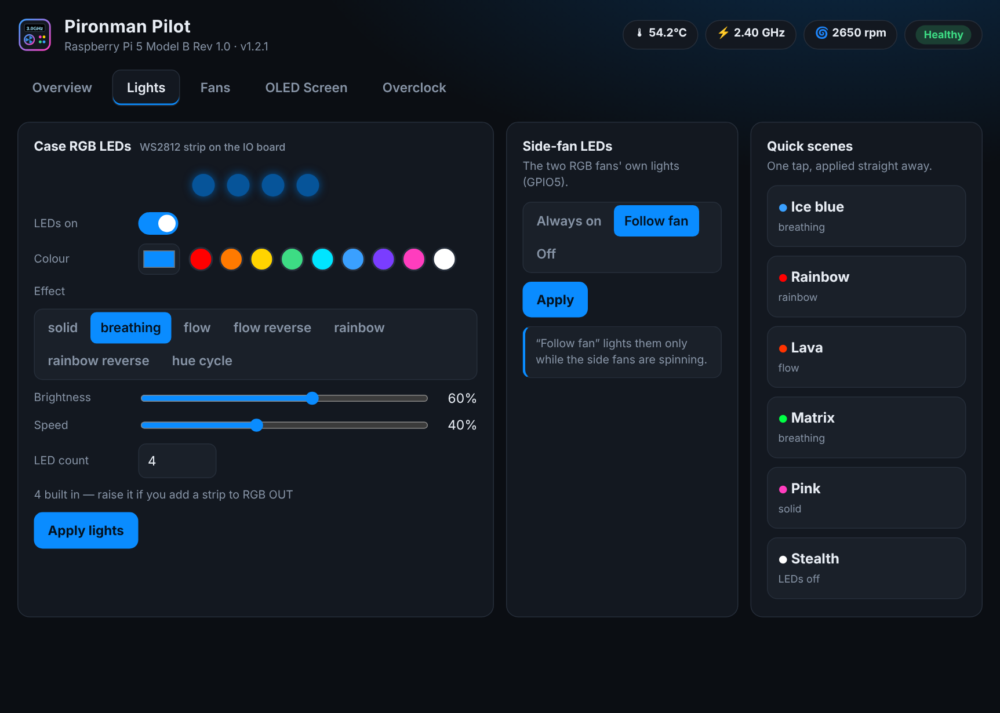
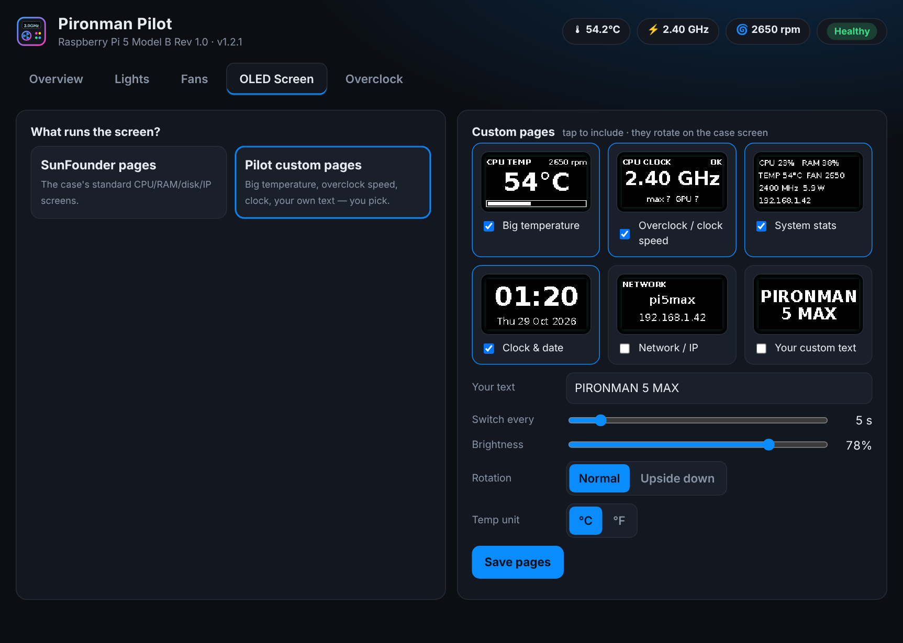

# Pironman Pilot


A control center for the **SunFounder Pironman 5 MAX** case on a **Raspberry Pi 5**.

| Tab | What you can do |
|---|---|
| **Overview** | Live CPU temp, clock, load, RAM, tower-fan RPM, side-fan state, core voltage, chip power, throttle/power health, 3-minute graph |
| **Lights** | Case RGB LEDs on/off, colour, effect (solid, breathing, flow, rainbow, hue cycle), brightness, speed, LED count, side-fan LEDs (on / follow fan / off), one-tap scenes |
| **Fans** | **Make it quieter**: one-tap silent setup and a live CPU speed limit (1.5–2.2 GHz). Tower fan: instant **Turbo cooling** (100% now) and fan-curve presets (Whisper, Silent, Quiet, Stock, Cool, Max, Custom). Side RGB fans: SunFounder on/off modes **or** a Pilot speed curve (Whisper, Silent, Balanced, Cool, Custom) with live graph and a speed tester |
| **OLED Screen** | Use SunFounder's pages (on/off, rotation, sleep, °C/°F) **or** Pilot's own pages: big temperature, overclock speed, system stats, clock, network, your own text — with live previews |
| **Overclock** | Presets 2.6 / 2.8 / 3.0 GHz or custom CPU, GPU and voltage boost, **safe test boot**, built-in stability test, back-to-stock button |

## Install

1. Install SunFounder's `pironman5` software first if you haven't (from their Pironman 5 MAX guide) — it drives the LEDs, side fans and its own OLED pages.
2. Copy this folder to the Pi, open a terminal in it and run:

```bash
bash install.sh
```

3. Open **Pironman Pilot** from the menu (System Tools) or the desktop icon, or type `pironman-pilot`.

Everything else (stats, tower fan, custom OLED pages, overclocking) works even without `pironman5`.

## Safe overclocking — how it works

* **Safe test boot** writes your settings into `/boot/firmware/tryboot.txt` and reboots once with the Pi 5's *tryboot* feature.
* If it boots: run the **stability test** (3–10 min). If it passes, press **Keep** — only then is it written to `config.txt`.
* If it freezes or never boots: **unplug and replug the power**. The Pi starts on its normal `config.txt` again and Pilot tells you the test didn't stick.
* **Apply without safety net** writes straight to `config.txt` (for when you already know it's stable).
* Every change to `config.txt` is backed up to `/etc/pironman-pilot/backups/`.

Rough guide for a Pi 5 with the MAX's tower cooler: 2.6 GHz works on nearly every board, 2.8 GHz on most, 3.0 GHz on good chips. Above 3.0 GHz is experimental and needs current firmware (`sudo apt full-upgrade`). Use the official 27 W (5 V 5 A) supply — under-voltage shows up on the Overview tab.

## Good to know

* Pilot runs as a small background service (`pironman-pilot.service`) on its own port (47821 by default, or the next free one — saved in `/etc/default/pironman-pilot`), only reachable from the Pi itself.
* If the icon ever shows a message instead of the app, run `sudo systemctl restart pironman-pilot`, or re-run `install.sh`.
* LED / side-fan / SunFounder-OLED changes go through the `pironman5` command and restart its service, so they take a couple of seconds.
* Fan curves and overclocks live in `config.txt`, so they need a reboot. Turbo cooling is instant.
* When Pilot's custom OLED pages are on, SunFounder's OLED pages are switched off (and switched back on when you pick them again or uninstall).
* **Side-fan speed curve:** the side fans are simple 2-wire fans on GPIO6. Pilot pulses that pin (PWM, via `python3-lgpio`) to run them at partial speed, and moves SunFounder's fan control to spare pin **GPIO26** so the two don't fight. Don't use this if you have something wired to GPIO26. Switching back to "On/off by temperature" (or uninstalling) returns GPIO6 to SunFounder. If Pilot ever stops, the side fans are left running at full speed.
* With the speed curve on, set the side-fan LEDs to "Always on" or "Off" — "Follow fan" follows SunFounder's on/off logic, not Pilot's curve.
* Logs: `journalctl -u pironman-pilot -f`

## Uninstall

```bash
bash uninstall.sh
```

Removes the app and takes Pilot's overclock / fan-curve lines out of `config.txt` (backup kept). Reboot to be back on stock clocks.

## Screenshots
| | |
|---|---|
|  |  |
|  |  |
|  | |
